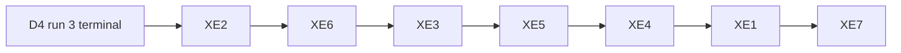

# D4 Lessons: Execution-Evidence Hardening Plan

> Publication review — 2026-11-16, based on `461e73b`.
> This is proposed work or retained research provenance, not implementation approval.
> Dated observations and validation reports below describe their original candidates.
> The current [audit record](completion/audit-hardening.json) records bounded acceptance;
> mutation qualification remains `CLOSED_NON_PASS`. Rebind execution dependencies
> and evidence before any separately authorized implementation.
> See the [review record](reviews/2026-11-16/d4.md).

Status: PROPOSED 2026-11-07; planning only. No implementation, rule pack,
dispatcher check, workflow, or release change is authorized by this document.
The 2026-11-07 proposal recorded a freeze on `main` during the D4 sequence.
This publication on `audit/hardening-acceptance` does not change `main`, declare
run 3 validated, or lift any freeze. Before execution or a merge to `main`,
verify the then-current run state and obtain the required scope decision.

Backlog item: [docs/backlog/d4-lessons-execution-evidence.md](backlog/d4-lessons-execution-evidence.md).
Scheduling entry: [TODO P0-XE](engagement/TODO.md).

## Why

Between 2026-11-03 and 2026-11-07 the D4 full-scope mutation path reached its
first qualifying-shaped execution only after seven fix cycles. Every defect had
the same root: code and workflow were authored against a VM mental model, were
declared ready on green unit tests, and first executed in the real container on
the CI gate — one defect per run. The gate limited each miss to about one hour
instead of eighteen, but it was the first execution, not the second.

Fettle's thesis is that a readiness claim must be accountable to evidence that
the thing ran where it will run. These defects are that thesis failing one
layer below where Fettle currently looks. The table records what failed, what
would have caught it, and which package below makes that catch a mechanism.

| # | Defect (run / PR) | Cost | Mechanism that would have caught it | Package |
|---|---|---|---|---|
| 1 | `python:3.12.13-slim` has no `git` (PR #62 review) | 1 PR cycle | Workflow never executed at edited SHA; container rehearsal | XE-1, XE-5 |
| 2 | Container git "dubious ownership" (gate run 42156076978) | 1 cycle + run | Container-job invariant; rehearsal | XE-5 |
| 3 | Container step runs `sh`; `[[` fails (42193150589) | 1 cycle | Container-job invariant | XE-5 |
| 4 | Bare `python` bypasses pinned venv (pre-empted in PR #66) | — | Container-job invariant | XE-5 |
| 5 | Synthetic preflight lacked `revision` (42317146142) | 1 cycle | Local rehearsal of a self-contained step | XE-1 |
| 6 | Diagnostic written to `*.tmp`, never retained (same run) | Blind failure | Retained-output rule | XE-4 |
| 7 | `d4-preflight-shards` missed the container fixes (42344083136) | 256 failed jobs, ~500 runner-min | Container-job invariant across all workflows | XE-5 |
| 8 | `deadline_ms=300` timing race on macOS (41947219300) | 1 rerun | Timing-sensitive-test rule | XE-3 |
| 9 | `timeout_s=1` fixture under mutmut load: 3 `tool_error` shards (41623594476) | Opaque non-pass | `tool_error` classification; timing rule | XE-2, XE-3 |
| 10 | `.fettle.toml` edit widened advisory to 256 shards, twice | ~24 h wall | Scope-widening notice | XE-6 |

Process lessons (one push per cycle, enumerate siblings before an "edit only"
order, batch fixes by class, quote gate evidence in approvals) stay in operator
discipline skills, not in Fettle.

## Scope and non-goals

In scope: advisory and classification mechanisms in existing seams —
`fettle/dispatcher_registry.py::CHECKS`, `rules/` semgrep packs,
`fettle/mutation_test.py` aggregation, and the mutation playbook.

Not in scope: new required CI gates, any change to `passed = skipped == 0` or
outcome budgets, survivor waivers, D4 criteria, a Docker dependency in Fettle's
runtime, enforcement of any new rule by default, or an implicit change to `main` during an active D4 sequence.

## Priority order and rationale

| Order | Package | Why this position |
|---|---|---|
| 1 | XE-2 `tool_error` classification | Smallest change; hardens the D4 runs themselves; turns an opaque non-pass into a named test |
| 2 | XE-6 scope-widening notice | Trivial; prevents the single most expensive avoidable cost (12 h advisory) |
| 3 | XE-3 timing-sensitive-test pack | Small; two incidents this week; protects every future mutation corpus |
| 4 | XE-5 container-job pack | Small; four incidents this week; purely static |
| 5 | XE-4 retained-output rule | Small; converts blind failures into diagnosable ones |
| 6 | XE-1 never-executed-workflow Stop advisory | Moderate (needs `gh`); highest conceptual value, but XE-3/4/5 catch most instances statically first |
| 7 | XE-7 playbook: gate-before-fan-out pattern | Documentation; last because the others make it concrete |

## Packages

Each package lists owner seam, behavior, acceptance, falsification, and
estimate. Acceptance means a fixture-driven test that fails before and passes
after. Falsification names the evidence that would show the package did not
earn its place.

### XE-2 — Classify `tool_error` shards by cause

Owner: `fettle/mutation_test.py` (`aggregate_shards`, `aggregate_d4_shards`,
shard report writer); tests in `tests/test_mutation_test.py`.

Behavior:
- A shard report with `status: tool_error` gains `tool_error_class` ∈
  {`baseline_test_failure`, `engine_crash`, `dependency_missing`,
  `interrupted`, `unknown`} and, for `baseline_test_failure`, `failing_tests`
  (list of pytest node IDs parsed from retained stderr `FAILED <id>` lines).
- Aggregates summarise `tool_error_classes` with counts and the union of
  `failing_tests`. The aggregate `message` names the first failing test when the
  class is `baseline_test_failure`.
- No change to pass semantics: `tool_error` remains non-pass and unknown.

Acceptance:
- Fixture stderr with `FAILED tests/x.py::test_y` → class
  `baseline_test_failure`, `failing_tests == ["tests/x.py::test_y"]`.
- Fixture stderr with a mutmut traceback and no `FAILED` line → `engine_crash`.
- Fixture with `ModuleNotFoundError`/`ImportError` at import of a pinned
  dependency → `dependency_missing`.
- Real-artifact test: the three retained `tool_error` reports from run
  41623594476 attempt 2 (shards 14, 42, 235) classify as
  `baseline_test_failure` naming
  `tests/test_verify_gate.py::TestRunVerify::test_timeout_after_source_change_preserves_unknown_pre_run_evidence`.
- Aggregate on a 256-report fixture with three such shards reports
  `tool_error_classes == {"baseline_test_failure": 3}` and stays non-pass.

Falsification: a `tool_error` shard whose retained stderr is empty must
classify `unknown`, never a guessed class.

Estimate: 0.5–1 day.

### XE-6 — Mutation scope-widening notice

Owner: new PostToolUse check `fettle/mutation_scope_notice.py` registered in
`CHECKS` (advisory only, `budget_ms` ≤ 20, not `fail_closed`); reads
`_MUTATION_WATCH_NAMES` from `fettle/mutation_test.py` rather than duplicating
the list.

Behavior: when an edit lands on a watch-name file, emit one advisory:
"Editing `<file>` widens changed-scope mutation to the full corpus
(`full_shards` shards; last observed full run ≈ N min from
`.github/mutation-observed-ledger.json` when present)". Once per file per
session.

Acceptance: fixture edit of `.fettle.toml` → advisory text contains the file
name and the configured shard count; edit of `fettle/foo.py` → no output;
second edit of the same file in the session → no repeat.

Falsification: the check must never block or change the mutation scope itself;
a test asserts decision is `advisory` for every input.

Estimate: 0.5 day. Requires an `event-map.md` row; `test_event_map_covers_all_dispatcher_and_transport_events` must stay green.

### XE-3 — Timing-sensitive-test rule pack

Owner: `rules/timing-sensitive-tests.yml` (semgrep, Python), `rules/PROVENANCE.md`
entry, advisory wiring through the existing PostToolUse quality scan; corpus in
`tests/fixtures/rules/timing/`.

Rules (all WARNING, paths scoped to test files):
- `time.sleep(...)` in a test or fixture body.
- `subprocess.run(..., timeout=<int < 30>)` or `timeout_s=<int < 30>` /
  `timeout=<int < 30>` keyword in a test.
- Wall-clock deadline literals below 1000 ms passed to a dataclass `replace` or
  constructor in a test (`deadline_ms=`, `poll_interval_ms=` excluded).
- A test that starts a subprocess and asserts on a side effect of that
  subprocess without waiting for it to exit.

Acceptance: `semgrep scan --config rules/timing-sensitive-tests.yml --validate`
passes; positive fixtures reproduce the PR #63 `timeout_s=1` fixture and the
`deadline_ms=300` test and each yields exactly one finding; negative fixtures
(the deterministic fake-`subprocess.run` pattern, `timeout_s=30`,
`deadline_ms=3000`) yield zero findings.

Falsification: more than one finding per fixture, or any finding in Fettle's
own `tests/` after PR #64, means the rules are too broad for an advisory
default.

Estimate: 1 day.

### XE-5 — Container-job rule pack

Owner: `rules/ci-container-jobs.yml` (semgrep YAML language), provenance entry;
generalises `tests/test_ci.py` container-job invariant added in the
post-preflight fix (PR after 42344083136).

Rules (WARNING, paths `.github/workflows/*.yml`):
- Job has `container:` and no step whose `run:` contains
  `safe.directory "$GITHUB_WORKSPACE"` before any other `git` use.
- Job has `container:` and no `defaults.run.shell: bash` while any step `run:`
  contains `[[`, arrays, `<<<`, `$'`, or `pipefail`.
- Job has `container:` and a `run:` line beginning with `python ` while another
  step creates a venv (`uv venv`, `python -m venv`).
- `container.image` without an `@sha256:` digest.
- `container.image` matching `python:*-slim*` while any step invokes `git`.

Acceptance: positive fixtures reproduce gate attempts 1–3 and the preflight
job as of `65c51f0`; each yields exactly the expected rule; the current
`mutation-d4.yml` and `mutation-d4-shard.yml` yield zero findings.

Falsification: a finding on `ci.yml` or `release.yml` container jobs that the
operator judges correct-as-is means the rule needs a documented exception
mechanism before advisory default.

Estimate: 1 day.

### XE-4 — Retained-output rule

Owner: same pack as XE-5 (`rules/ci-container-jobs.yml`) or a sibling
`rules/ci-evidence-retention.yml`.

Rule (WARNING): within one job, a `run:` step redirects stdout to a file
(`> name`, `| tee name`) and no `actions/upload-artifact` step in that job lists
that file (or a parent directory) with `if: always()`.

Acceptance: fixture reproducing the pre-#67 shard step (`> mutation-report.json.tmp`
not uploaded) yields one finding; the post-#67 step yields none.

Falsification: findings on redirects of obviously transient files
(`/dev/null`, `$GITHUB_OUTPUT`, `$GITHUB_ENV`) mean the rule needs an
allow-list before default.

Estimate: 0.5 day (shared infrastructure with XE-5).

### XE-1 — Never-executed-workflow Stop advisory

Owner: new Stop check `fettle/workflow_execution_gate.py` in `CHECKS`
(advisory only; `required_when` false unless `[gates.workflow_execution]
enabled = true`); uses `gh` when available and reports `UNKNOWN` honestly when
it is not.

Behavior: at Stop, if the session edited any `.github/workflows/*.yml`, resolve
the current HEAD and ask `gh run list --workflow <file> --commit <sha>`. For each
edited workflow with no run at that SHA, advise: "`<file>` changed this session
and has not executed at `<sha>`"; if the edited job has `container:`, append
"container jobs have failed on first execution four times (see
d4-lessons-implementation-plan.md); rehearse with `docker run` or dispatch the
cheapest phase before claiming done". If `gh` is absent or unauthenticated,
advise "execution status UNKNOWN (gh unavailable)". Never blocks.

Acceptance: fixture edits list + fake `gh` returning no runs → advisory names
the file; fake `gh` returning a run at HEAD → no output; fake `gh` missing →
UNKNOWN advisory; edits without workflow files → allow silently. Budget
≤ 2000 ms with a 1500 ms `gh` timeout.

Falsification: any path where this check returns `block`, or where it reports
"executed" without a run ID it can quote, fails the package.

Estimate: 1–1.5 days. Requires `event-map.md` and `behavior-map.md` rows.

### XE-7 — Playbook: gate-before-fan-out pattern

Owner: `docs/mutation-quality-playbook.md`, new section after "D4 dispatch
preconditions".

Content: the pattern Fettle's own workflows use and that users with their own
matrices should copy — a cheap job the fan-out `needs:`, executing the real
shard path in the exact target image on a one-manifest synthetic corpus;
local `docker run` rehearsal command for container jobs; retain every
redirected output with `if: always()`; classify `tool_error` by cause before
suspecting infrastructure. Every sentence maps to a mechanism in XE-1..XE-6 or
an existing workflow line; `tests/test_doc_claims.py` style check added for the
section's named files.

Estimate: 0.5 day.

## Sequencing and dependencies

The historical proposal allowed XE-2 branch preparation during the freeze.
No such implementation is authorized by this publication. Recheck candidate-bound
D4 evidence and current merge restrictions before any implementation decision. XE-5 depends on the container-job invariant test already on
`main`; XE-4 shares its YAML rule infrastructure. XE-1 is last among mechanisms
because XE-3/4/5 catch most instances statically and XE-1 adds a network
dependency.

## Verification route

- Each package: fixture tests that fail on `main` before and pass after;
  `semgrep --validate` for every edited pack; `fettle check --changed`; ruff;
  focused owning-test files; `tests/test_doc_claims.py`.
- Packs ship advisory-only. Promotion to a default or enforcing pack requires
  a separate decision with observed false-positive counts from at least one
  full `fettle bench` run.
- No package may change mutation pass semantics; a regression test on
  `aggregate_shards` output for a fixed fixture guards this across XE-2.

## Risks

- Rule packs over-fire on legitimate timing tests (XE-3) or on
  non-D4 container jobs (XE-5). Mitigation: advisory default, allow-list
  mechanism documented before promotion.
- XE-1 depends on `gh` and network; mitigation: honest `UNKNOWN`, never block.
- Scope creep into "a Docker runner inside Fettle". Explicitly out of scope;
  XE-1 advises the operator to rehearse, it does not rehearse.

## Decision requested

The planning publication is authorized. Any XE implementation requires a new
scope decision after reconciling current D4 evidence and the existing mechanisms
in the behavior map. No main-branch merge or freeze change is authorized here.
